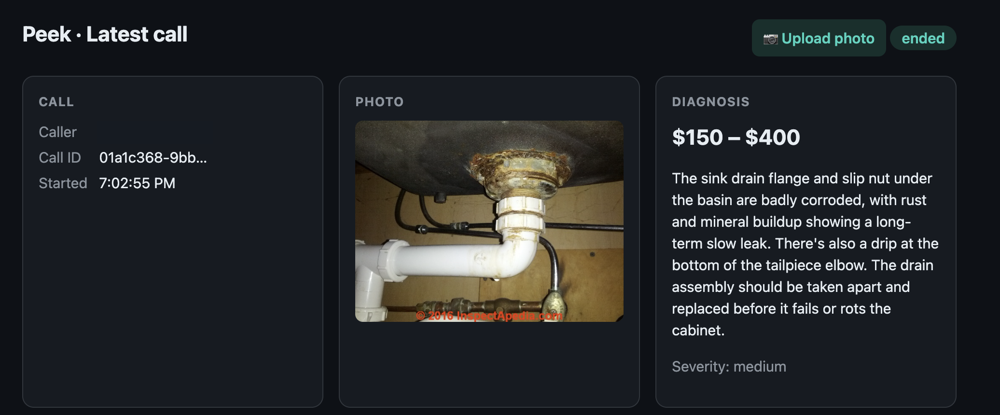
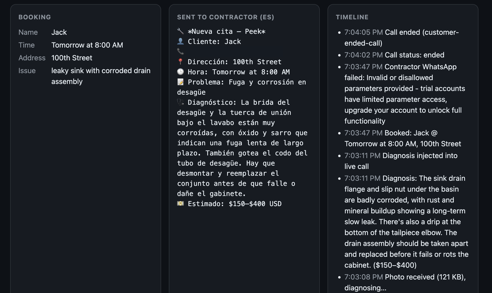

# Peek 🔧📸

**An AI phone receptionist for plumbers. It sees the problem before anyone drives out.**

A customer calls about a leak. Peek answers, texts them on WhatsApp to send a photo, looks at the photo with AI, and tells them **on the same call** what's wrong and roughly what it'll cost. If they want a visit, Peek books it and sends the plumber a summary **in Spanish**, with the photo, diagnosis, price, address and time.

No app to download and no forms. The customer just calls and sends a photo.

## Why WhatsApp and Spanish?

- **Trades already run on WhatsApp, not software.** In the US, **54% of Hispanic adults use WhatsApp, compared with 20% of white adults** ([Pew Research Center, 2023](https://www.pewresearch.org/internet/fact-sheet/social-media/)). Jobs get quoted, scheduled and coordinated through informal chats and calls rather than booking systems. Peek works inside the tools crews already use.
- **Much of the workforce works in Spanish.** About **1 in 3 US construction workers is Hispanic (32%)** ([NAHB, 2025](https://eyeonhousing.org/2025/10/hispanics-comprise-nearly-one-third-of-the-construction-labor-force/)), and more than half in Texas, California and New Mexico. An English-speaking customer and a Spanish-speaking plumber can still work together, because Peek handles the translation.
- **Photos save trips.** Without a photo, a plumber often drives out just to quote the job. With one, the customer gets a price range on the call and the plumber shows up knowing what to bring.

## How it works

1. **Call:** the customer calls Peek's number ([Vapi](https://vapi.ai) voice agent, with [Deepgram](https://deepgram.com) Nova-3 speech-to-text).
2. **Photo:** Peek sends them a WhatsApp message ([Twilio](https://twilio.com)) with a link to upload a photo.
3. **Diagnosis:** Claude vision looks at the photo and returns a short diagnosis and a price range.
4. **Spoken on the call:** the diagnosis is added to the live conversation (Vapi Live Call Control), so the agent says it right away.
5. **Booking:** Peek collects name, address and time, then WhatsApps the plumber a summary in Spanish.

## The dashboard is just for tracking and demoing

The customer never sees it. It's a live behind-the-scenes view of the current call (photo, diagnosis, booking, and the Spanish message sent to the plumber), plus an **Upload photo** button so the flow can be demoed without WhatsApp.




## Run it

```bash
npm install
cp .env.example .env   # add Vapi, Twilio and Anthropic keys
npm start              # http://localhost:3000/dashboard
ngrok http 3000        # then set PUBLIC_URL in .env to the ngrok URL and restart
node scripts/setup-vapi.js <assistantId> <ngrok-url>   # creates the Vapi tools and configures the assistant
```

**Stack:** Node.js + Express, Vapi (voice agent), Deepgram (speech-to-text), Twilio WhatsApp, Claude (vision + Spanish summary). Everything is kept in memory; there's no database.

**Hackathon caveats:** Twilio trial accounts need approved WhatsApp templates for business-initiated messages, so the dashboard upload is the reliable demo path. Prices are AI estimates, not quotes.
